<picture><source media="(prefers-color-scheme: dark)" srcset="https://raw.githubusercontent.com/tungnguyen1208/tungnguyen1208/main/assets/hero-dark.svg?v=1794269354"><source media="(prefers-color-scheme: light)" srcset="https://raw.githubusercontent.com/tungnguyen1208/tungnguyen1208/main/assets/hero-light.svg?v=1794269354"></picture>

<a href="https://www.linkedin.com/in/nguy%E1%BB%85n-t%C3%B9ng-485b50369/"><picture><source media="(prefers-color-scheme: dark)" srcset="https://raw.githubusercontent.com/tungnguyen1208/tungnguyen1208/main/assets/badge-linkedin-dark.svg?v=1794269354"><source media="(prefers-color-scheme: light)" srcset="https://raw.githubusercontent.com/tungnguyen1208/tungnguyen1208/main/assets/badge-linkedin-light.svg?v=1794269354"></picture></a><a href="https://github.com/tungnguyen1208"><picture><source media="(prefers-color-scheme: dark)" srcset="https://raw.githubusercontent.com/tungnguyen1208/tungnguyen1208/main/assets/badge-github-dark.svg?v=1794269354"><source media="(prefers-color-scheme: light)" srcset="https://raw.githubusercontent.com/tungnguyen1208/tungnguyen1208/main/assets/badge-github-light.svg?v=1794269354"></picture></a><a href="mailto:trunbnguyen@gmail.com"><picture><source media="(prefers-color-scheme: dark)" srcset="https://raw.githubusercontent.com/tungnguyen1208/tungnguyen1208/main/assets/badge-gmail-dark.svg?v=1794269354"><source media="(prefers-color-scheme: light)" srcset="https://raw.githubusercontent.com/tungnguyen1208/tungnguyen1208/main/assets/badge-gmail-light.svg?v=1794269354"></picture></a>

<a href="https://github.com/tungnguyen1208?tab=repositories"><picture><source media="(prefers-color-scheme: dark)" srcset="https://raw.githubusercontent.com/tungnguyen1208/tungnguyen1208/main/assets/impact-dark.svg?v=1794269354"><source media="(prefers-color-scheme: light)" srcset="https://raw.githubusercontent.com/tungnguyen1208/tungnguyen1208/main/assets/impact-light.svg?v=1794269354"></picture></a>

  IT Engineering student at the <strong>University of Transport and Communications (UTC)</strong>, Hanoi, Vietnam. 
  I enjoy building web applications and backend APIs, exploring AI/ML and computer vision, and experimenting with embedded IoT systems. I learn by turning ideas into projects, testing them, and improving them step by step.

## Stack

<picture>
  <source media="(prefers-color-scheme: dark)" srcset="https://raw.githubusercontent.com/tungnguyen1208/tungnguyen1208/main/assets/stack-dark.svg?v=1794269354">
  <source media="(prefers-color-scheme: light)" srcset="https://raw.githubusercontent.com/tungnguyen1208/tungnguyen1208/main/assets/stack-light.svg?v=1794269354">
  
</picture>

  

<b>Build. Deploy. Monitor. Improve.</b>

