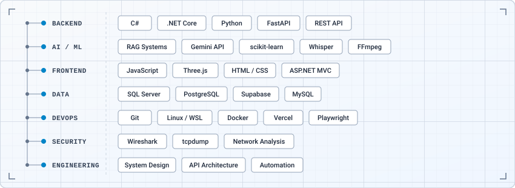

  

  
  
  

  
  

 

  <strong>Software Engineer based in Hanoi · Building Backend and Intelligent Systems</strong> 
  I enjoy building practical backend applications, exploring AI-powered systems, and automating repetitive work. I focus on learning by designing, implementing, testing, and improving real projects.

## Tech Stack

  

## Behind the Code

  
    
  <strong>Build. Deploy. Monitor. Improve.</strong>

---

  Thanks for visiting my profile. Feel free to connect!

